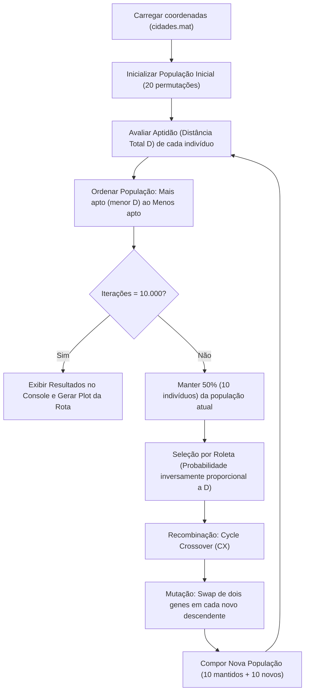

# Especificação Técnica do Trabalho: Algoritmos Genéticos (Caixeiro Viajante - TSP)

**Disciplina:** Inteligência Artificial (IA) — BCC FURB  
**Tema:** Busca Local — Algoritmos Genéticos aplicados ao Problema do Caixeiro Viajante (*Traveling Salesperson Problem* - TSP)  
**Branch de Desenvolvimento:** `caua`  
**Repositório:** `c:\Dev\AlgoritmosGeneticos_IA_BCC_FURB_2026`

---

## 1. Visão Geral e Objetivo

O trabalho consiste na implementação de um agente inteligente baseado em **Busca Local por Algoritmos Genéticos (AG)** para solucionar o clássico **Problema do Caixeiro Viajante (TSP)**.

O objetivo do agente é determinar a rota de menor custo (menor distância euclidiana total percorrida) que:
1. Parte de uma cidade inicial (Cidade 1);
2. Visita cada uma das outras $n - 1$ cidades **exatamente uma vez**;
3. Retorna à cidade de partida, fechando o circuito.

---

## 2. Parâmetros e Suposições do Problema

| Parâmetro | Valor / Descrição |
| :--- | :--- |
| **Número de Cidades ($n$)** | 20 cidades |
| **Espaço de Coordenadas** | Plano quadrado $1 \times 1$ ($x \in [0, 1], y \in [0, 1]$), carregadas do arquivo `cidades.mat` |
| **Representação Cromossômica** | Vetor de permutações de números inteiros de $1$ a $20$ (ou índices $0$ a $19$) |
| **Tamanho da População ($N$)** | 20 indivíduos |
| **Critério de Parada** | 10.000 iterações (gerações) |
| **Simetria de Distância** | Distância euclidiana simétrica: $d(c_i, c_j) = d(c_j, c_i)$ |
| **Taxa de Renovação** | **50% elitismo/seleção** (metade da população é mantida) e **50% novos descendentes** gerados via crossover e mutação |

---

## 3. Formulação Matemática

### 3.1. Representação da Rota (Cromossomo)
Um cromossomo é uma permutação ordenada de tamanho $n = 20$:
$$C = [c_1, c_2, \dots, c_n]$$
onde cada gene $c_k \in \{1, 2, \dots, n\}$ e $c_i \neq c_j$ para $i \neq j$.

### 3.2. Função de Aptidão (Fitness / Custo)
A aptidão é calculada pela distância euclidiana total $D$ do ciclo completo, incluindo o retorno de $c_n$ para $c_1$ ($c_{n+1} = c_1$):

$$D = \sum_{k=1}^{n} d(c_k, c_{k+1}) = \sum_{k=1}^{n} \sqrt{(x_{k+1} - x_k)^2 + (y_{k+1} - y_k)^2}$$

> **Nota:** Como se trata de um problema de **minimização**, quanto **menor** a distância $D$, **mais apto** é o indivíduo.

---

## 4. Arquitetura dos Operadores Genéticos

### 4.1. Ordenação e Distribuição Inversa de Probabilidade
1. Os cromossomos são avaliados e dispostos em **ordem crescente de distância total $D$** (do mais apto ao menos apto).
2. Para a seleção por roleta, como distâncias menores são melhores, as probabilidades devem ser atribuídas de forma **inversamente proporcional**:
   - Exemplo com fitness inverso: $w_i = \frac{1}{D_i}$ ou ranking inverso linear $w_i = (N - i + 1)$.
   - Probabilidade do indivíduo $i$:
     $$P(i) = \frac{w_i}{\sum_{j=1}^{M} w_j}$$

### 4.2. Seleção por Roleta
- É utilizado o método da **roleta viciada** (*Roulette Wheel Selection*) para sortear os pais que participarão da reprodução, favorecendo os indivíduos com menor distância.
- Metade da população atual é preservada para a próxima geração, e a outra metade é gerada pelos descendentes.

### 4.3. Recombinação: Cycle Crossover (CX)
A técnica de ciclo preserva a validade da permutação (sem repetir nem omitir cidades). O algoritmo segue os passos especificados:
1. **Ponto inicial:** Escolhe-se um local (índice) aleatório no cromossomo.
2. **Passo 1:** Os dois cromossomos pais trocam os genes nesse local, gerando os descendentes com um número duplicado em cada um.
3. **Passos seguintes:** Identifica-se a posição original do número duplicado no descendente 1 e troca-se com o valor correspondente na mesma posição do descendente 2.
4. **Resolução de ciclo:** Repete-se a troca até que nenhuma duplicata reste e ambos os descendentes representem permutações válidas de $1$ a $n$.

#### Exemplo de Cycle Crossover (Documento Oficial):
- **Pais:**
  - $P_1$: `[4, 1, 5, 3, 2, 6]`
  - $P_2$: `[3, 4, 6, 2, 1, 5]`
- **Local sorteado:** Posição 4 (valores trocados: `3` e `2`)
  - **Passo 1:**
    - $D_1$: `[4, 1, 5, 2, 2, 6]` (duplicado: `2`)
    - $D_2$: `[3, 4, 6, 3, 1, 5]` (duplicado: `3`)
  - **Passo 2:** Troca no local da duplicata (posição 5):
    - $D_1$: `[4, 1, 5, 2, 1, 6]` (duplicado: `1`)
    - $D_2$: `[3, 4, 6, 3, 2, 5]` (duplicado: `3`)
  - **Passo 3:** Troca no local da nova duplicata (posição 2):
    - $D_1$: `[4, 4, 5, 2, 1, 6]` (duplicado: `4`)
    - $D_2$: `[3, 1, 6, 3, 2, 5]` (duplicado: `3`)
  - **Passo 4:** Troca no local da nova duplicata (posição 1):
    - $D_1$: `[3, 4, 5, 2, 1, 6]` *(Válido!)*
    - $D_2$: `[4, 1, 6, 3, 2, 5]` *(Válido!)*

### 4.4. Operador de Mutação (*Swap Mutation*)
- Escolhe aleatoriamente duas posições $i$ e $j$ ($i \neq j$) no cromossomo de um novo descendente e troca seus genes:
  $$C[i], C[j] = C[j], C[i]$$
- O operador atua sobre **cada membro da nova geração gerado por reprodução**.

---

## 5. Requisitos de Saída e Entrega

### 5.1. Saída na Janela de Comando (Terminal)
Ao final das 10.000 iterações, o programa deve imprimir:
1. **Tamanho da População:** `20`
2. **População Inicial:** Amostra ou representação da população na iteração 0
3. **População Final:** Representação da população na iteração 10.000
4. **Número de Cidades:** `20`
5. **Melhor Custo:** Menor distância total $D$ encontrada
6. **Melhor Solução:** Sequência ordenada de cidades que compõem o melhor trajeto

### 5.2. Visualização Gráfica (`Plot`)
- Utilizar `matplotlib.pyplot` para plotar:
  - Os pontos $(x, y)$ das 20 cidades dispersas no plano $[0, 1] \times [0, 1]$.
  - As linhas conectando as cidades na ordem da **Melhor Solução**, fechando o ciclo na primeira cidade.
  - Identificação de cada cidade (número/índice) junto aos pontos.
  - Título com o custo da melhor solução.

### 5.3. Critérios de Avaliação Acadêmica
- Código comentado linha a linha ou em blocos explicativos.
- Formato final de entrega exigido pelo professor: arquivo `.zip` ou `.ipynb` com o padrão:
  `T2_Aluno1_Aluno2_Aluno3.zip` ou `T2_Aluno1_Aluno2_Aluno3.ipynb`.

---

## 6. Diagnóstico do Código Atual (`AgenteGenetico.py`)

| Ponto | Situação Atual | Ação Necessária |
| :--- | :--- | :--- |
| **Carregamento de dados** | `np.loadtxt("cidades.mat")` | Funciona, mas `cidades.mat` possui cabeçalhos do Octave; validar parsing correto. |
| **Representação dos genes** | Armazena instâncias de `Cidade` no cromossomo | Recomenda-se armazenar **números inteiros (1 a 20)** conforme a especificação, consultando as coordenadas por índice. Facilita o *Cycle Crossover* e a impressão. |
| **Avaliação (`avaliados.append`)** | Linha 40: `avaliados.append(cromossomo, aptidao)` | **Erro de sintaxe Python:** `append()` aceita apenas 1 argumento (deve ser tupla `(cromossomo, aptidao)`). |
| **Ordenação (`ordenados = avaliados.sort()`)** | Linha 42: `.sort()` in-place retorna `None` | Corrigir para `avaliados.sort(key=...)` ou `sorted()`. |
| **Operadores Faltantes** | Inexistentes no código atual | Implementar: Seleção por Roleta Inversa, Cycle Crossover (CX), Swap Mutation e loop de 10.000 gerações. |
| **Plot e Saídas** | Inexistentes | Implementar prints exigidos e visualização gráfica com `matplotlib`. |
